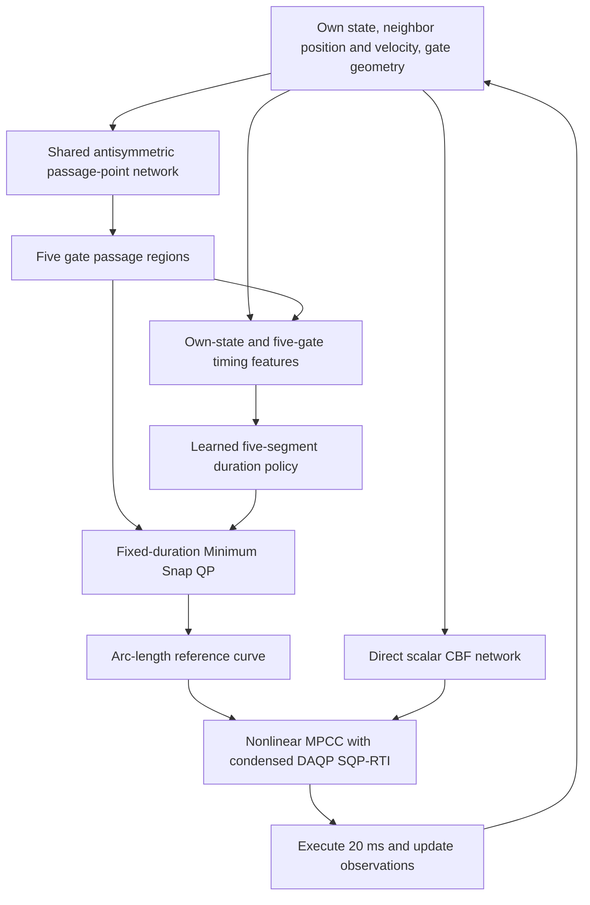

# CBFracing

CBFracing combines learned gate-passage allocation, learned segment durations, polynomial reference planning, and nonlinear model predictive contouring control (MPCC) with a learned control barrier function (CBF). The current default configuration uses a five-gate Minimum Snap reference planner and a condensed DAQP solver for SQP-RTI updates.

## Method

Each quadrotor observes its own state, the gate geometry, and the current position and velocity of its neighbor. Both vehicles use shared network parameters and independently construct their references. Neighbor motion is predicted from current and historical observations. Planning proceeds on a common physical time grid, and each vehicle replans after passing its current gate.

The implementation uses state observations in simulation. Each reference contains five physical gate events, with the first gate serving as the current passage target. Vehicle motion continues through subsequent planning calls using the measured state. Only the initial takeoff state is stationary.



### Passage-point network

The passage allocator takes 24 normalized features. Six describe relative position and velocity in gate-related coordinates. The remaining features describe the gate relative to the pair midpoint, mean velocity, gate normal and lateral axis, and the following gate geometry.

A shared MLP has dimensions `24 → 48 → 48 → 1`, with Tanh hidden activations. It is evaluated on the original features and on features with the six relative components negated. Its output is

\[
o_\phi(z)=0.45\tanh\!\left(f_\phi(z)-f_\phi(\mathcal Rz)\right).
\]

The resulting lateral offset lies within ±0.45 m. For gate center \(g_j\) and lateral axis \(a_j\), the predicted passage point is \(g_j+o_\phi(z_j)a_j\). The antisymmetric construction gives opposite offsets when the relative features are reversed and the common features agree. A private passage memory limits updates to overlapping future gate offsets to 0.2 m per successful replan in the default configuration.

The allocator is trained using collision, crossing, motion, and offset losses evaluated on a differentiable trajectory surrogate. The current default uses the saved checkpoint in `models/allocation.pt`. The implementation is in [allocation.py](cbfracing/networks/allocation.py) and [train.py](train.py).

### Time-allocation network

The default timing policy receives 54 features from the own-vehicle state and the five predicted passage regions. These comprise position, velocity, quaternion, body rates, relative gate positions, gate normals, passage half-widths, and normalized collective thrust.

|Component|Architecture|Role|
|---|---|---|
|Base time policy|54 → 128 → 128 → 64 → 5|Predicts normalized log durations|
|Bounded residual|54 → 64 → 5|Applies a bounded multiplicative correction to the frozen base policy|
|Short-segment residual|54 → 32 → 5|Adjusts segments whose geometric distance is below 3 m|

Hidden layers use Tanh. The residual heads have bounded Tanh outputs. The final short-segment policy follows

\[
\log T_j=\log T_{\mathrm{bounded},j}
+m_j b\tanh r_j(z),
\qquad
m_j=\mathbf 1[d_j<3\,\mathrm m],
\]

with \(b=0.3\) for the integrated checkpoint. Durations are clamped to [0.15, 8] s. The default checkpoint is `models/snap_short_residual_v2/events.pt`.

Timing supervision uses subsequent executed gate intervals from audited rolling flights. The bundled dataset contains 60 training and 20 validation examples, split by complete flight run. The short-residual training objective combines masked log-duration regression with a 0.02-weighted anchor to the frozen policy. The integrated trainer also supports a direct time MLP initialized from scratch. Network definitions and the training procedure are in [event_supervised.py](cbfracing/networks/event_supervised.py) and [events.py](cbfracing/training/events.py).

### Minimum Snap reference generation

The planner represents each of the five segments with a seventh-degree Bernstein polynomial and minimizes

\[
\min_c\ \sum_{j=1}^{5}\int_0^{T_j}
\left\|p_j^{(4)}(t)\right\|^2\,dt.
\]

The predicted durations are fixed during this solve. Constraints connect the initial position, velocity, and acceleration to the measured state, preserve position through jerk continuity across segments, enforce gate passage regions and forward passage velocity, and bound sampled positions within the world. The default configuration also matches the initial jerk components transverse to the current thrust axis.

With fixed durations, the default kinematic problem is a convex QP solved by Clarabel. The resulting position samples are converted into an arc-length reference for MPCC. Full rigid-body constraints are enforced by the downstream controller and checked on executed trajectories. The implementation is in [minimum_snap.py](cbfracing/planning/minimum_snap.py) and [reference.py](cbfracing/planning/reference.py).

### Learned CBF and MPCC

The CBF network receives 22 normalized features consisting of relative position and velocity, own velocity, attitude, body rates, rotor thrusts, pair distance, and radial relative velocity. A `22 → 32 → 16 → 1` Tanh MLP directly predicts a scalar \(h_\psi\). Its checkpoint is `models/direct_cbf_v2/h.pt`. Training includes safe/unsafe classification, a derivative-condition loss, and a scale-fitting term. The differentiable scalar is exported into the MPCC formulation. The implementation is in [barrier.py](cbfracing/networks/barrier.py) and [safety_train.py](cbfracing/training/safety_train.py).

MPCC carries a 19-dimensional state containing position, velocity, quaternion, body rates, four rotor thrusts, virtual path progress, and virtual progress speed. Controls are the four thrust derivatives and virtual progress acceleration. Its objective combines contour and lag errors, control regularization, and progress reward. The default progress coefficient reaches 4200 and is limited toward 900 in curved reference sections. A reference-speed preview further modulates this coefficient.

The controller imposes rigid-body dynamics, actuator and body-rate limits, spatial bounds, physical gate-crossing constraints, and learned-CBF constraints. It requires \(h_k\geq0\) throughout the prediction horizon. For the first three prediction intervals, the default hard decay condition is

\[
h_{k+1}-e^{-3\Delta t}h_k\geq \rho\Delta t,
\qquad \rho=0.04\,\mathrm{s}^{-1}.
\]

Later decay violations receive a penalty. The applied control interval has additional dense checks. The margin \(\rho\) is a configured robustness term. Actual simultaneous-vehicle trajectories are independently checked against the original sampled CBF decay condition.

The prediction horizon is 20 × 0.08 s, and the feedback interval is 0.02 s. The first three prediction intervals use four subsegments for gate-intersection checks. SQP-RTI uses compiled derivative kernels, Gauss–Newton curvature, dynamics condensing, and DAQP, with up to 16 updates per call. Applied-interval nonlinear feasibility determines control acceptance, while full-horizon residuals are separately logged. An optional SQP restoration is counted in the reported runtime. The implementation is in [control/](cbfracing/control/).

## Installation and execution

Run commands from the project directory and use a new output name for each run.

```powershell
python -m pip install -r requirements.txt

# Default learned-time Minimum Snap reference and RTI MPCC
python validate.py --name snap_demo

# Select the branch and a custom timing checkpoint
python validate.py --name custom_demo --frontend minimum-snap --event-checkpoint models/my_times/events.pt

# Inspect available options
python validate.py --help

# Audit the executed flight and generate its animation
python -m cbfracing.evaluation.integration_report outputs/snap_demo
python -m cbfracing.evaluation.render outputs/snap_demo
```

`--rti-kernels auto` loads the compiled kernel when its problem hash matches. Otherwise, symbolic derivatives are selected and the reason is recorded. `--rti-kernels native` requires a matching native kernel, and `--rti-kernels symbolic` selects symbolic evaluation. The supplied DLL was verified on Windows x64 with the current CasADi configuration. The local DAQP extension targets Python 3.12 on Windows. Other environments can install DAQP through `requirements.txt`.

The default Minimum Snap start is aligned with Gate 1. `--start-mode original` selects the original supplied start. The alternative planning branches remain available through `--frontend phase` and `--frontend original`. The original complementarity CPC requires `--preview-gates 2`. IPOPT MPCC can be selected with `--mpcc-backend ipopt`.

## Training

```powershell
# Train a direct five-event time policy from scratch
python train.py --task time --frontend minimum-snap --name my_times --steps 2000

# Train the bounded short-segment residual used by the current approach
python train.py --task time --architecture short --name my_short_times --log-bound .3 --steps 2000

# Supply a custom timing dataset
python train.py --task time --name custom_times --dataset data/custom_events.npz --steps 3000

# Train the passage allocator or direct scalar CBF
python train.py --name my_allocator --steps 2500
python train.py --task cbf --name my_cbf --steps 4000
```

Timing datasets contain `features[N,54]`, positive `targets[N,5]`, and disjoint `train` and `val` index arrays. Group samples from the same flight into the same split. The default data file is `data/events_rollout.npz`. Training writes `events.pt` and `training.json` to `models/<name>/`. The `short` architecture freezes the bounded base checkpoint, and its `--initial` option selects that checkpoint. The direct architecture trains all time-policy parameters.

## Results

All runs below use the original-scale Split-S course, two quadrotors, two laps per vehicle, five-gate rolling previews, and a stationary initial state aligned with Gate 1. The physical model uses mass 0.85 kg, per-rotor thrust bounds of 0–7 N, body-rate norm limit 10 rad/s, and body-frame linear drag coefficients [0.26, 0.28, 0.42] kg/s. Gate dimensions are 0.4 × 1.5 × 1.5 m. Translational speed is unconstrained.

### Experimental separation sweep

The following runs use the integrated 900-turn-reward configuration. Lap times in the table refer to the second lap.

|Initial separation|UAV 1 lap time|UAV 2 lap time|Peak speed across both UAVs|Failed QPs / restorations|
|---|---|---|---|---|
|1.2 m|5.8997 s|5.9186 s|18.7628 m/s|0 / 0|
|1.3 m|5.9035 s|5.9098 s|19.0116 m/s|0 / 0|
|1.4 m|5.9182 s|6.0080 s|18.9391 m/s|0 / 0|

Each run completed 14 ordered gate crossings per vehicle and passed the physical and actual sampled-CBF audits. First-lap times, which include acceleration from rest, span approximately 6.26–6.56 s. Full metrics and experiment identifiers are recorded in the [experimental report](../minimum_snap_times_20261105/DENSE_GATE_ITERATION.md).

### Validation inside CBFracing

`outputs/integration_snap_full_20261105/` reproduces the 1.3 m experiment with elementwise-identical executed states. Retraining the short-segment residual for 2000 steps inside this project and loading the resulting checkpoint reproduced the same flight in `outputs/integration_trained_time_20261105/`.

|Metric|Integrated validation|
|---|---|
|Gate crossings per UAV|14 / 14|
|Total simulated flight duration|12.48 s|
|Peak speeds of UAV 1 / UAV 2|19.0116 / 18.6850 m/s|
|Second-lap times of UAV 1 / UAV 2|5.9035 / 5.9098 s|
|Dense minimum inter-vehicle distance|1.01516 m|
|MPCC median / 95th-percentile runtime|24.93 / 53.29 ms|
|Mean reference-generation runtime|15.38 ms across 29 calls|
|Controller construction time|7.01 s|
|Failed QPs / restorations|0 / 0|
|Physical, CBF, passage-allocation and time-policy audits|Passed|

Timing values refer to this specific serial validation run. Computation latency is recorded separately from simulated physical time. The current measurements exceed the 20 ms feedback interval for some controller calls. Scope is limited to the evaluated course and initial conditions, with numerical replay and sampled safety checks.

The 5.9 s goal remains unmet simultaneously for both vehicles across the separation sweep. A previous coarse-intersection variant achieved 5.8876/5.8863 s at 1.3 m separation, then failed at 1.4 m. The default uses the refined intersection formulation. For the legacy phase branch, the aligned-start single-gate check passed. Two original-start tests failed near 0.7 s, with logs retained in their output directories.

The fixed-duration reference QP is convex. Time-policy learning and the full MPCC problem retain their nonlinear structure. The current short-segment residual tends toward its lower bound, so the available experiments establish course-specific performance. Broader adaptation and generalization require additional data and evaluation.

The integrated report contains complete audits, and the animation includes executed paths and speed curves. File hashes and source provenance are recorded in the integration manifest. [Validation report](outputs/integration_snap_full_20261105/index.html) · [Integration manifest](INTEGRATION_20261105.json)


## Code organization

|Location|Responsibility|
|---|---|
|`train.py`|Training arguments, task selection, passage-allocation training loop|
|`validate.py`|Closed-loop arguments, planning, control execution, logging|
|`cbfracing/core/`|Vehicle dynamics, course, configuration, runtime settings|
|`cbfracing/networks/`|Passage allocator, duration policies, direct CBF|
|`cbfracing/planning/`|Minimum Snap, phase planner, complementarity CPC, references, initial guesses|
|`cbfracing/control/`|Nonlinear MPCC, SQP-RTI, QP condensing, DAQP, neighbor prediction|
|`cbfracing/training/`|Timing-policy and CBF training procedures|
|`cbfracing/evaluation/`|Physical replay, network verification, reports, animations|
|`cbfracing/tools/`|Derivative-kernel compilation and numerical verification|
|`models/`, `data/`|Saved checkpoints and training datasets|
|`build/`|Compiled kernels and problem-hash metadata|
|`outputs/`, `results/`|Per-run trajectories, controls, metrics, logs, source snapshots|
