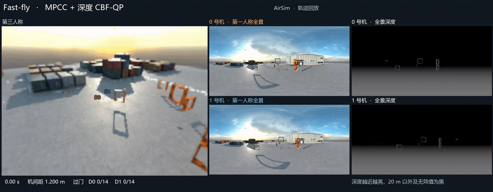

# AirSim360 双机 Split-S 竞速

## 双机两圈回放



历史航次 `cf21_fastfly_force_sync01` 使用 Fast-fly、MPCC 和深度 CBF-QP。两机各通过两圈共 14 道门，仿真用时 **12.82 s**，最小中心距 **0.5719 m**。本次回放使用当时的 **0.85 kg** 动力学和 Crazyflie 2.1 外观。[航次摘要](reports/spatial_potential/cf21_fastfly_force_sync01/flight/summary.json)

## 当前闭环

从项目根目录启动。每次运行使用一个新名称。

```powershell
.\scripts\monitored_flight.ps1 -Race -Name split_s_race01
```

入口是 `scripts/control/race.py`。两机从 1.2 m 间距出发，各飞两圈 14 门。Fast-fly 滚动规划，MPCC 分别跟踪。两机过首门后，深度估计驱动联合三阶 CBF-QP；执行后的八路控制更新推力。CPU 温度与 WHEA 监控由 PowerShell 启动器负责。

`-Race` 使用 Crazyflie 2.1 标准有刷版的 CF2X 近似模型。Fast-fly、MPCC、联合 CBF 和闭环积分器共用所选机体的动力学参数，每次运行将其保存到 `adapter/config.json`。质量为 27 g，机臂长 39.7 mm，惯量对角元为 [1.4, 1.4, 2.17] × 10⁻⁵ kg·m²，单桨最大推力 0.1490 N。基于 CF2X 的推重比和悬停转速换算推力上限与常系数阻力。推力变化率上限 4.257 N/s 沿用原控制器从零到满推力的 35 ms 设计值。Fast-fly 使用当前模型的符号导数和 IPOPT 进行滚动求解。AirSim 负责渲染，物理状态由闭环积分器推进。参数实现见 `scripts/control/crazyflie21.py`。[CF2X 机体参数](https://github.com/utiasDSL/gym-pybullet-drones/blob/main/gym_pybullet_drones/assets/cf2x.urdf) · [阻力模型](https://github.com/utiasDSL/gym-pybullet-drones/blob/main/gym_pybullet_drones/envs/BaseAviary.py)

控制与训练使用 `.conda-envs/risk-training`，AirSim 渲染子进程使用 `.venv`。求解器配置、权重、历史对照用的原生库和训练轨迹在 `assets/flight/`。航次目录为 `reports/spatial_potential/<名称>/`。

| 目录 | 职责 |
|---|---|
| `scripts/control` | 闭环入口、MPCC 求解与 CBF-QP |
| `scripts/planning` | `minsnap/` 放 Minimum Snap 与 Guan 多项式分支，`fast_fly/` 放滚动规划，`cpc/` 放 CPC 及航门约束求解，`utils/` 放共享工具，`utils/test/` 放独立验证入口 |
| `scripts/perception` | 全景几何、深度里程计、邻机估计及风险模型 |
| `scripts/simulation` | 刚体动力学、赛道、AirSim 相机与航次采集 |
| `scripts/training` | 教师数据生成与模型训练 |
| `scripts/evaluation`、`scripts/replay` | 指标复核、曲线和多视角回放 |

可以按文件路径直接启动 Python 脚本，也可以用 `python -m scripts.<功能>.<模块>`。按文件运行时，相对数据路径以项目根目录为基准。独立重算一次五门规划的示例：

```powershell
.\.conda-envs\risk-training\python.exe .\scripts\planning\utils\test\recheck_fast_fly.py reports/spatial_potential/cf21_physics_verify01/flight
```

它用已记录的初态、航点和时间初值重新求解并检查动力学与航门约束。旧实验使用 `scripts.control.run_spatial_mpcc`。例如，查看 CBF 对照复核的输入参数可运行 `.\.conda-envs\risk-training\python.exe -m scripts.evaluation.audit_pair_cbf --help`，五视角回放可运行 `.\scripts\monitored_flight.ps1 -Name split_s_video01 -ReplayFlight split_s_race01 -CbfReplayFfmpeg <ffmpeg.exe路径>`。

## 历史实验记录

本文及飞行报告统一将网络从连续 RGB-D 观测预测的运动目标风险称为**动态风险场**（dynamic risk field）。给定空间位置和预测提前量，网络输出 0 到 1 的**动态风险值**，值越大表示该位置的预测风险越高。门框等固定表面贡献的风险称为**静态风险**。

2026-11-05 已配置并运行官方 **AirSim360 Pro Beta / FactoryExteriorInteriorBundle**，安装目录为本项目的 `simulator/`，Python 3.10.22 环境为 `.venv/`。GPU 为 RTX 5080 16GB。

运行状态更新：2026-11-05 22:01 后已关闭本聊天启动的仿真进程以释放显存。实测进程占用约 13.2 GiB，关闭后整卡显存使用由 15187 MiB 降至 1748 MiB，GPU 利用率由 98% 降至 8%。此前保留的运行时飞行器/模型随进程结束消失，磁盘数据仍保留。可按下文重新启动；测试结束应退出仿真器。详情见 `reports/gpu_memory_diagnosis.json`。

## 测试结论

### 双机互相观测图像（2026-11-06）

交付目录：`captures/mutual_observation_20261106_191733/`。`drone_1_observation.png` 是 A 观察 B，`drone_2_observation.png` 是 B 观察 A；两者均为 2048×1024 原始全景的 640×426 局部裁剪，未做亮度修改或内容合成。完整全景、原始深度、目标移走对照和可见性掩码同目录保留。

**实现限制**：本次原生 `BP_Drone` 机身未在测试全景中显示，故为两架可控飞行器分别使用一份包内 `Quadrotor1` 可见外观，在定格采集时同步到相应全局位置；拍摄观察者图像时，观察者自己的外观移出场景，只显示目标外观。这是可见外观模型方案，不是原生机身直接互视成功的证明，也不是旧测试场景遗留模型。图像仍由仿真器实际渲染，没有后期粘贴无人机。

A 位于全局 NED `(0,0,-3.1131)` 米，B 位于 `(2.5,0,-3.5841)` 米；使用原始比例 1，水平间距 2.5 米。目标移走对照在 A、B 深度图中分别改变 4097、3866 个像素，并已人工检查两张观测图中确有目标。相机/外观状态冻结采集，不代表同步连续飞行的完整外观绑定功能已经实现。

复现：`.\capture-mutual-observation.ps1`。该入口在完成或异常时自动关闭本项目仿真进程释放显存。原生机身测试的两个早期诊断目录未作为交付图像。

### 双机并行飞行与全景 RGB/深度（2026-11-05）

实测两架同时起飞、并行运动并分别返回全景 RGB 和深度。8 秒运动指令期间，两架水平位移分别约 `+3.51m`、`-3.28m`，记录到 7 个双机同时在空中且速度超过 0.15m/s 的采样点。

**场景构成补充**：这批历史数据采集时还保留了上一轮生成的两个静态 `Quadrotor1` 测试模型，因此当时共有两架可控飞行器和两架静态模型。静态模型也会出现在 RGB 和深度图中。逐一移开模型的对照实验已确认两路深度均受到它们影响，记录在 `reports/drone_visibility_check/report.json`。这批数据保留了当时场景中的两个静态模型。

- 数据目录：`captures/dual_flight_20261105_212937/`。
- 每架 4 组，合计 8 张 RGB PNG、8 份 float32 深度 NPY，单帧 512×256。
- `dataset.npz` 提供无损汇总，RGB 形状 `(2,4,256,512,3)`，深度形状 `(2,4,256,512)`。
- `preview.png`、`flight_trajectory.png` 分别为图像预览与轨迹/速度图；`validation.json` 记录文件回读校验。
- 本运行包将浮点深度装在 `image_data_uint8` 字节缓冲区中，脚本按小端 float32 解码，不能只读取空的 `image_data_float`。
- 97.89% 的深度像素位于分析范围 `0 < d <= 1000`，其余大值（包括 32256）原样保留，并附分析掩码。深度物理单位尚未独立标定。
- RGB 与深度采用顺序触发，时间差约 33–123ms，不是严格同步采集。相机位姿字段为零，需参考另存的飞行器状态，不能直接用作相机外参。
- 18 秒时限的 `landAsync` 返回失败；随后两架均成功解除电机使能并释放 API 控制，状态查询速度为零。未据此宣称自主着陆验收通过。

完整报告见 reports/dual_flight_capture.json。

### 两架无人机资产测试（2026-11-05）

实测可以同时生成两份包内 `Quadrotor1` 无人机模型。Actor 名称分别为 `CodexTwoDroneModel_1` 和 `CodexTwoDroneModel_2`；两者在第二次生成后均能被场景查询找到，坐标有效。初始位置分别为 NED 米制 `(4,-2,-1.5)`、`(4,2,-1.5)`；将第一架移动至 `(4,-3,-1.5)` 后，第二架仍在原位置。测试后已保留这两个模型，重启场景后它们会消失。

此外，修正参数后，`simAddVehicle('CodexDrone2', 'SimpleFlight', pose, 'DefaultQuadrotor')` 已成功添加第二架飞行器。`listVehicles()` 同时返回 `BP_Drone_C_1`、`CodexDrone2`，两者均可分别查询状态，并通过一架关闭、另一架打开 API 控制的检查。目前两架均保留在场景中。同时起飞与并行采集已验证，见上节；编队和轨迹跟踪尚未测试。

此前进程退出的原因是测试脚本将 `pawn_path` 错传为完整蓝图路径。该参数实际是 `PawnPaths` 配置表的键；转储解码得到未处理的 C++ `std::out_of_range` 异常（`0xe06d7363`），与上游 `pawn_paths.at(...)` 查找缺失键的行为相符。将参数改为已经配置的 `DefaultQuadrotor` 后调用成功。此前的失败记录不能作为“不支持双机”的结论。旧记录保存在 `reports/two_drones_before_parameter_fix.json`，崩溃分析保存在 `reports/vehicle_crash_analysis.json`。

原始记录见 reports/two_drones.json。

| 项目 | 实测结果 |
| --- | --- |
| RPC、无人机、场景查询 | 正常；389 个可枚举资产、2133 个场景对象 |
| 生成包内 `Cube` | 成功；位置读取有效 |
| 修改缩放、移动、分割 ID、删除 | 成功；移动后坐标与期望误差小于 0.05m |
| 全景 RGB | 成功返回 512×256×3；另存有 1024×512 截图 |
| 外部 OBJ 文件路径作为资产参数 | 未导入；独立新进程中调用后进程退出、RPC 超时 |
| 外部 GLB 文件路径作为资产参数 | 未导入；独立新进程中调用后进程退出、RPC 超时 |
| 不存在的资产名称对照 | 同样导致进程退出、RPC 超时 |
| 普通相机名称 `0` | 当前包返回 Camera not found；请使用全景接口 |

`simSpawnObject` 的 `asset_name` 指项目资产数据库中的名称，不是外部模型文件路径。测试证实：本次官方运行包可以生成和操作已打包模型，**不能通过这一公开接口直接导入测试 OBJ/GLB**。官方客户端没有发现模型导入方法。不能由此推断所有未公开插件或未来版本的能力；FBX、USD、骨骼动画、材质贴图导入尚未测试。

包中没有 `.uproject` 或可供编辑的 UE 工程。若需要加入自有模型，需取得兼容的 AirSim360 UE 工程与插件，再通过 UE 编辑器导入、设置碰撞/材质并重新打包，或由开发方提供运行时导入接口。本次没有完成这条工程导入流程。

截图中下方存在大块灰色区域，因此图像返回成功不代表全景画质已全面通过验收。

## 使用（PowerShell 7）

```powershell
cd E:\work\20261105AirSim360
.\start-simulator.ps1
```

启动脚本默认离屏渲染，RPC 仅绑定 `127.0.0.1:41451`，重复启动会检查本项目记录的进程。场景首次初始化可能需要几秒。设置保存在根目录 `settings.json`，已保留官方 `BP_Drone` 蓝图、SE3 控制器和初始位置。

需要交互界面时，可在资源管理器打开：

`simulator\AirSim360_Pro_FactoryExteriorInteriorBundle\Windows\AirSim360.exe`

请先关闭本项目已运行的仿真进程，避免同一 RPC 端口冲突。运行包自带原版 `settings.json` 和 `AirSim360_Control_EN.exe`。

### 重建环境

```powershell
.\setup-python.ps1
python -m scripts.simulation.download_scene
python -m scripts.simulation.install_scene
```

需要 Conda、网络访问及已下载的官方客户端源码。`setup-python.ps1` 使用 `requirements.lock.txt` 固定全部 Python 运行依赖；`requirements.txt` 列出主要依赖。官方客户端以 editable 方式从 `upstream/AirSim360-main/software/Python_API_Env/PythonClient` 安装，不使用 PyPI 中另一个同名客户端替代。

## 证据文件

- `reports/asset_probe.json`：最终健康进程的包内资产与相机测试。
- `reports/import_obj.json`、`import_glb.json`、`import_missing.json`：各自独立新进程的外部导入和无效名称对照。
- `reports/available_assets.json`：389 项资产名称。
- `reports/panorama_before.png`、`panorama_after.png`：生成资产前后全景。
- `reports/panorama_elevated.png`：1024×512 全景采集样本。
- `reports/package_inventory.json`、`download_verification.json`：运行包清单及官方 SHA256 校验。
- `reports/environment.json`：环境与源码下载记录。
- `reports/asset_probe_initial.json`：首次诊断记录；无效名称导致退出后，后续请求受影响，**不作为外部格式测试结论的依据**。
- `logs/`：Python 测试输出及运行 PID。该 Shipping 包未生成所请求的 `simulator.log`，因此没有据此断言引擎内部崩溃原因，也未取得操作系统退出码。

测试模型为脚本自行生成的 1 米立方体 OBJ/MTL 和 GLB，没有第三方模型授权依赖。

## 官方来源

- [AirSim360 官方仓库](https://github.com/Insta360-Research-Team/AirSim360)
- [官方 Python 客户端说明](https://github.com/Insta360-Research-Team/AirSim360/tree/main/software/Python_API_Env)
- [官方 Windows Pro 场景包](https://huggingface.co/datasets/Insta360-Research/AirSim360/tree/main/AirSim360_Pro_Beta)
- [UE 资产导入流程](https://dev.epicgames.com/documentation/en-us/unreal-engine/importing-assets-directly-into-unreal-engine)

工厂 ZIP：794,594,876 字节；SHA256 `c0889daeeb7ede3ec3a979af359015dac921a7cfb0d69e6dfcc5ab7a833ceb5d`，与官方 LFS 元数据一致。运行包来源标注 CC-BY-NC-4.0，具体使用应遵循对应发布材料的许可。
